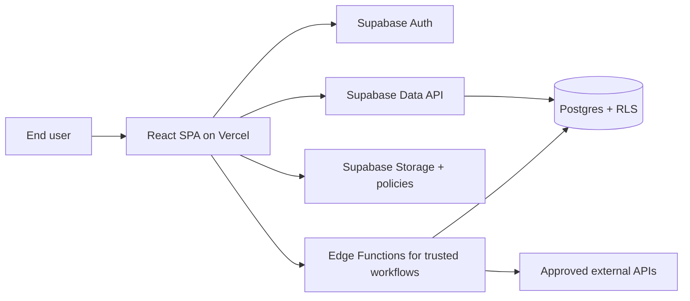

# System Architecture

## Context (example React + Supabase + Vercel)

**Trust boundaries:** The browser is untrusted; only publishable credentials belong there. Authorization is enforced at database policies and trusted server operations, not by hiding buttons. Function secrets remain server-side.

## Modules and responsibilities

| Module | Owns | Forbidden responsibility |
| --- | --- | --- |
| UI / routes | presentation, interaction, local form state | security enforcement or secret storage |
| Domain layer | reusable business logic, validation | platform-specific UI rendering |
| Data access | typed queries, error mapping | bypassing RLS without explicit authorization |
| Edge functions | webhooks, trusted actions, external secrets | allowing arbitrary unauthenticated writes |
| Database | durable invariants, data ownership, RLS | relying on frontend-only validation |

## Architectural decisions still to make

- SPA vs SSR: [decision]
- Tenant or per-user isolation: [decision]
- Real-time requirements: [decision]
- Storage/file access model: [decision]
- Background jobs, retries, idempotency: [decision]
- Soft delete and data retention: [decision]

## Required diagrams per critical workflow

Draw both the happy path and at least one failure/unauthorized path. Update API contracts/data model with any architectural change.
