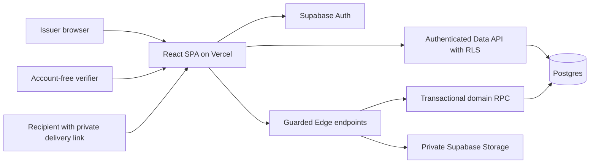

# VeriMark system architecture

Status: proposed MVP design, 2026-11-15; no deployed system is asserted.

The browser is untrusted and receives only project URL and publishable client key. Tenant membership is loaded from trusted database state on every sensitive operation. Platform administrator authority is separate from organization ownership. No service-role credential or secret is permitted in browser code, previews, logs or exports.

## Boundaries

| Component | Responsibility |
| --- | --- |
| Browser | Forms, preview, comparison instructions, loading/empty/error/success states; cannot approve by hiding buttons |
| Auth | Verified account identity, session recovery and expiration |
| RLS/Data API | Scoped tenant reads and narrowly allowed draft edits; no anonymous base-table listing |
| Edge | Validate identity or delivery capability, rate limits, request bounds, allowlisted public response, private download authorization |
| Postgres RPC | Membership/role checks, issuer eligibility, revision checks, atomic issuance/replacement/revocation and audit |
| Storage | Private template/evidence/PDF objects under explicit object policies |

Prefer user-scoped database clients so RLS remains effective. A privileged server client bypassing RLS must first authenticate the actor and authorize the exact tenant, role and resource from trusted state; caller-supplied actor IDs are never authority. A narrowly scoped internal worker authenticates separately and may only claim its assigned PDF jobs. See AUTH-AND-PERMISSIONS.md and RLS-AND-MIGRATIONS.md.

## Critical flows and failure paths

1. Owner creates organization; platform review records identity/authority review separately. Unreviewed issuers cannot issue. Review criteria and suspension effects on existing verification are unresolved product policy; fail closed for new issuance.
2. Issuer validates recipient rows and template, previews a revision, explicitly approves that exact revision, then requests issuance. RPC locks batch and relevant membership/organization state, checks approval digest, writes immutable snapshots, events, jobs and idempotency receipt in one transaction. Stale revision, removed membership or missing approval produces no issuance.
3. PDF rendering happens after commit in bounded resumable work. Failed rendering never causes duplicate issuance; status distinguishes issued record from PDF readiness. No long synchronous whole-batch render.
4. Verifier opens high-entropy public ID; throttled endpoint returns only allowlisted comparison fields and current server-computed status. Unknown ID is not found; database outage is unable to verify. Anonymous direct DB queries fail.
5. Recipient opens a separately scoped secret delivery capability and exchanges it for credential access/download. Public verification ID alone never authorizes private files or delivery details. No account is required. Token invalidation blocks new downloads; already issued signed URLs expire shortly and cannot be recalled reliably.
6. Revoke and replacement transactions serialize on credential lineage. Replacement creates a fresh immutable credential and links the predecessor; it never overwrites issued claims. Historical verification keeps its own status and optional replacement pointer without claiming the old document is current.

Authoritative effective status: revoked first, then replaced, then expired when database time is at or beyond expires_at, otherwise valid. Not found and unable to verify are lookup outcomes, not stored lifecycle statuses. UTC database timestamps govern expiry; client clocks are irrelevant. See API-CONTRACTS.md for public enum mapping.

No realtime dependency for MVP. Refetch lifecycle status after mutation and on verification load; responses use no-store. Basic usage metrics are tenant-scoped aggregates, without public recipient directories. Retention, redaction and lawful erasure must reconcile immutable history with privacy policy before real personal data is collected.
