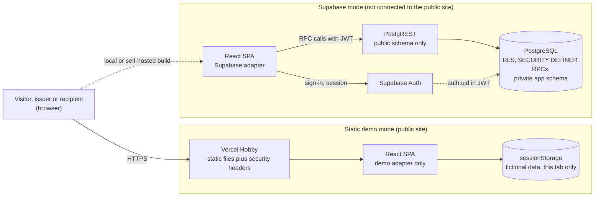
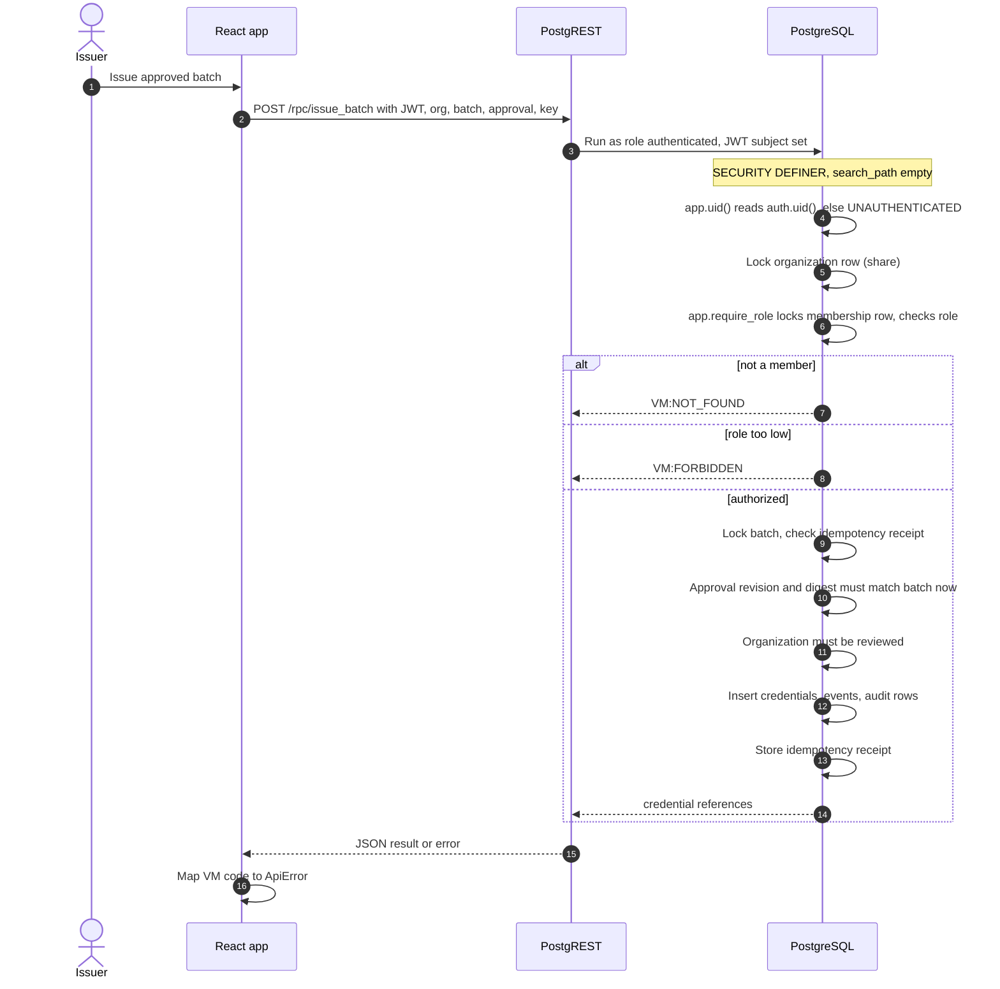
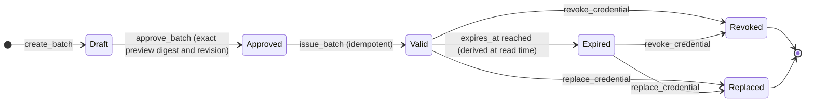
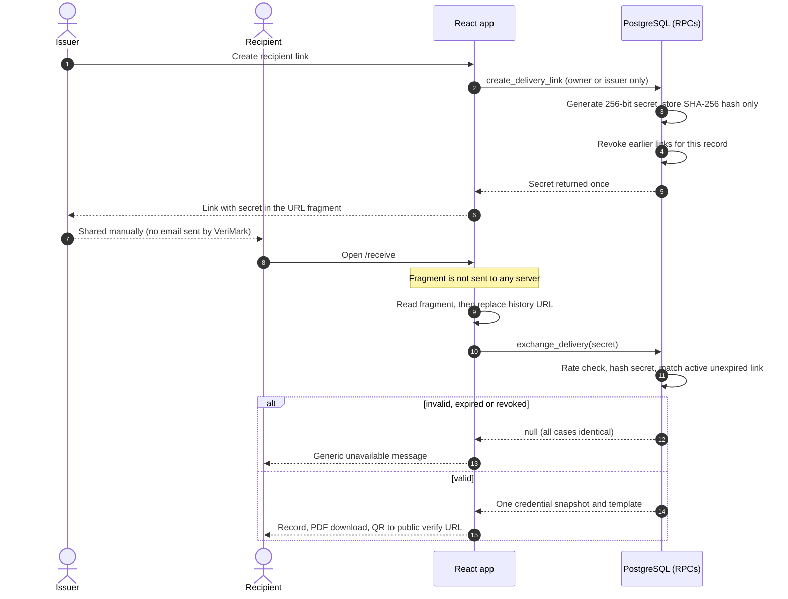
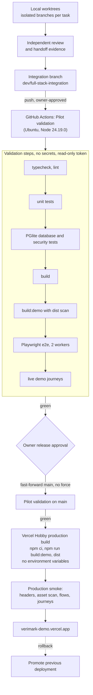

# VeriMark — architecture diagrams

Diagrams use [Mermaid](https://mermaid.js.org/) and render on GitHub. They describe the repository as built; see [CASE-STUDY.md](CASE-STUDY.md) for reasoning and [EVIDENCE.md](EVIDENCE.md) for verification status.

## 1. System context

*Caption:* One React codebase talks to a single `VeriMarkApi` contract with two adapters. The public site is the static demo: `npm run build:demo` compiles the Supabase adapter out, so no request can leave the site's origin. The Supabase mode is tested locally on PostgreSQL and on a disposable hosted project; it is not deployed. Dashed arrows indicate paths not used by the public site.

## 2. Authorization flow for an issuer RPC

Example: `issue_batch`.

*Caption:* Authority is decided entirely inside the database. The client holds only a JWT; base tables have no write grants, and every function derives the caller from `auth.uid()` and a row-locked membership. Non-members and unknown objects are indistinguishable (`NOT_FOUND`). Lock order is organization, then membership, then batch or credential rows.

## 3. Credential lifecycle

*Caption:* Issuance is a pipeline of explicit batch states (draft, approved, issued); `preview_batch` is a read that returns the digest the approval must match, and `issue_batch` re-checks that the approval's revision and digest still match the batch at issue time. After issue, status is computed at read time with precedence revoked, replaced, expired, valid. Revoke and replace each refuse a record that is already revoked or replaced (`INVALID_TRANSITION`), so those states are terminal and a revoked record can never read as valid again. Replacement also issues a successor record (next version in the same lineage) in the same transaction. Revoke and replace require a private reason and an idempotency key.

## 4. Recipient delivery

*Caption:* The delivery link is a hash-only bearer capability. The secret never reaches the database in plain form at rest, never appears in a request line or referrer (it lives in the fragment), and is removed from browser history on load. It is repeatable until expiry (30 days default) and is not proof of identity; replacement or revocation disables it.

## 5. CI/CD and release pipeline

*Caption:* Nothing is deployed before the integration branch passes Linux CI, and `main` must hold the release commit before Vercel first imports the repository. Hosted Supabase tests are never part of CI; they are separate, individually approved runs against a disposable project. Run IDs and results are in [EVIDENCE.md](EVIDENCE.md).
