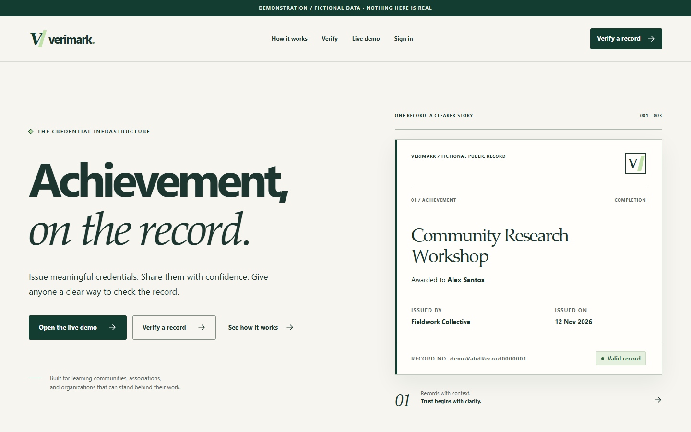
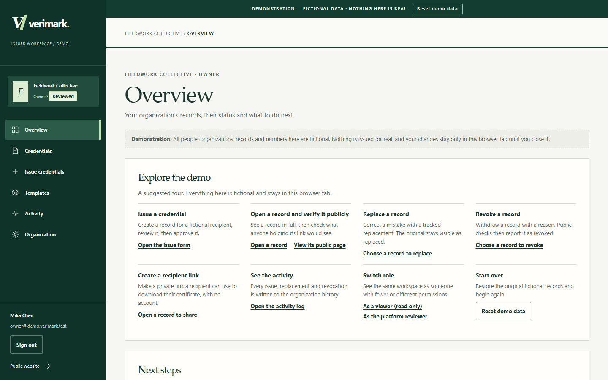
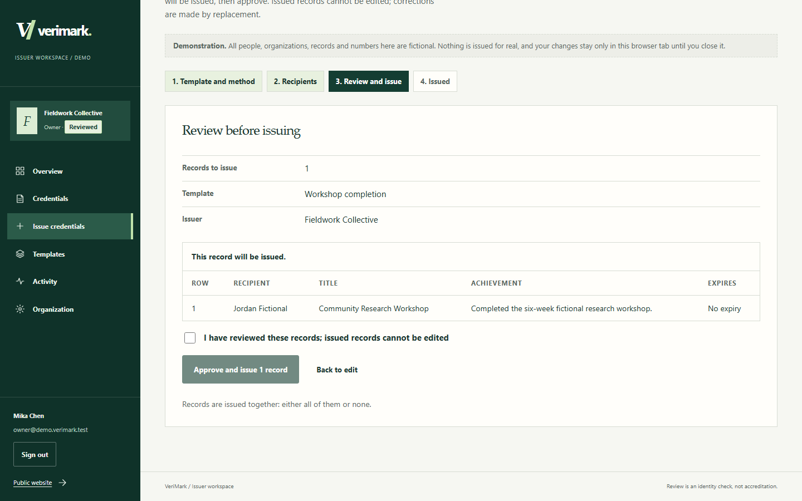
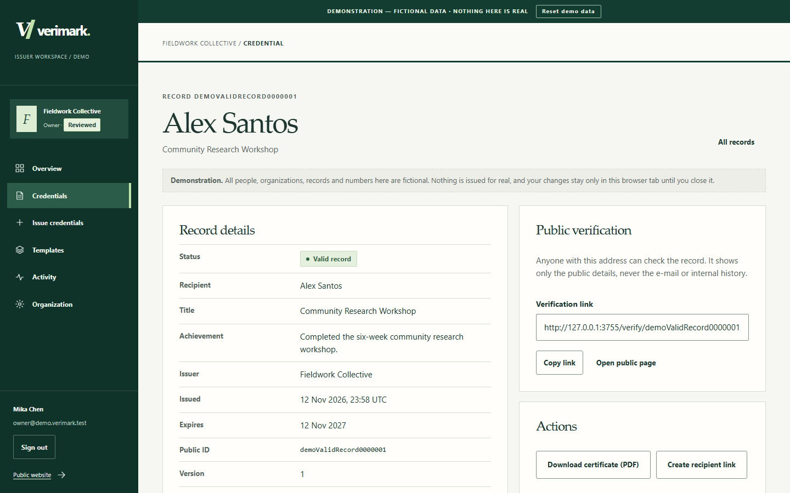
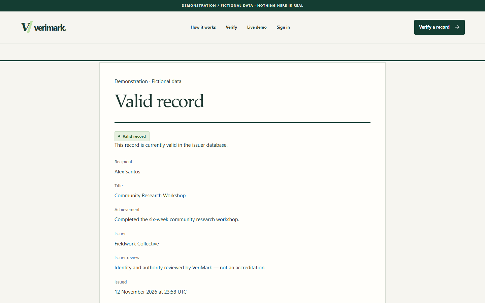
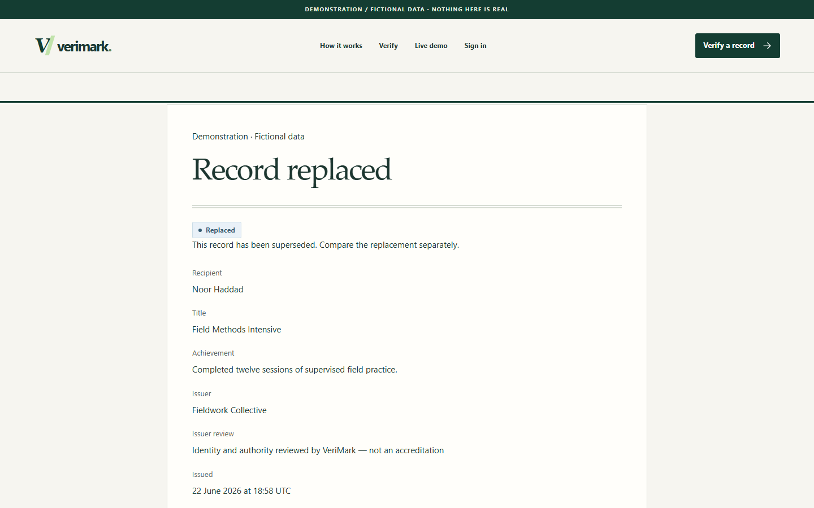
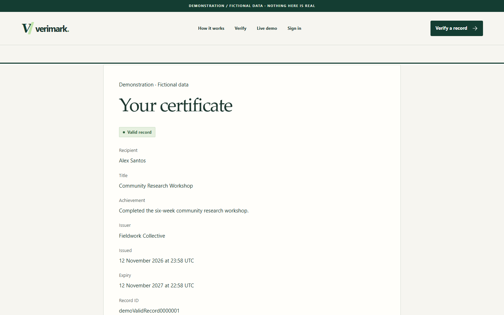
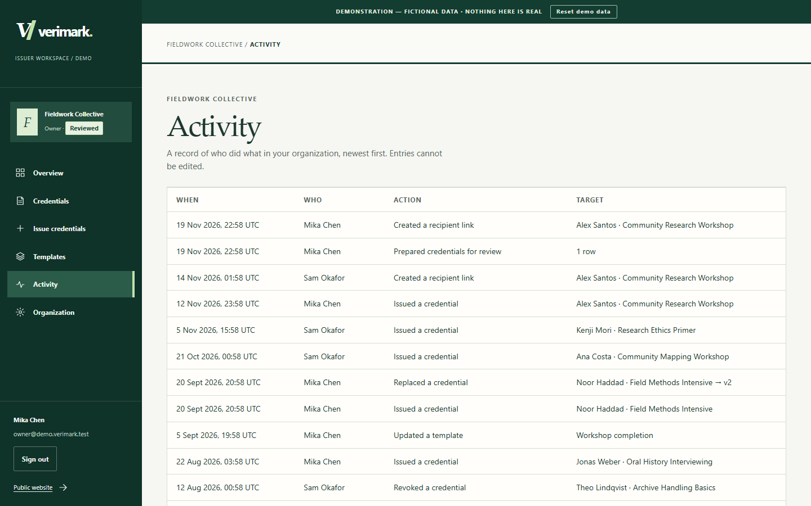
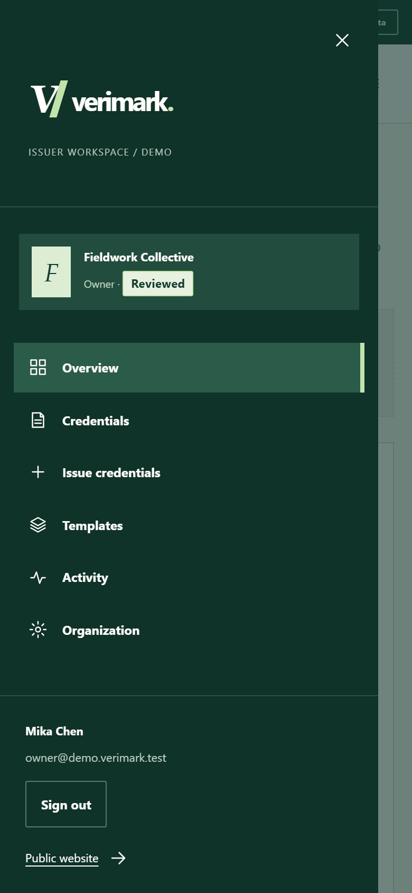

# VeriMark — technical case study

VeriMark lets a small organization issue accountable certificates, and lets a recipient or any third party check the issuer's record and its *current* status. This document describes what was built, how it was verified, and what is deliberately not done. Live demonstration: <https://verimark-demo.vercel.app> (fictional data, held in the visitor's own browser tab; no backend).

Evidence labels used throughout:

- **Implemented & verified** — built, and exercised by the named automated test or recorded run.
- **Implemented, not verified on hosted infrastructure** — built and tested locally, but never run against a hosted Supabase project.
- **Planned / not built** — a proposal or intent only.

[EVIDENCE.md](EVIDENCE.md) maps each claim to files and runs; [ARCHITECTURE.md](ARCHITECTURE.md) has the diagrams.

## 1. Problem and motivation

Paper and PDF certificates are trivially forged or silently outdated: a recipient cannot show that a certificate is still valid, and a verifier cannot tell whether it was corrected or withdrawn. Heavyweight credential platforms assume large institutions and integrations.

VeriMark targets the gap: an issuer-controlled, database-backed record that a third party can compare a document against. Its claim is deliberately narrow: verification confirms that *the issuer's database recognises the record and reports its current status*; it is not accreditation and not a cryptographic credential (PRD, `docs/product/PRD.md`; `README.md` "Scope").

## 2. Intended users and use cases

| Actor | Needs |
| --- | --- |
| Organization **owner** | Manage the organization, members, invitations, templates; issue and revoke |
| **Issuer** | Prepare, approve and issue single or CSV batches; revoke, replace, create recipient links |
| **Viewer** | Read records and activity only |
| **Platform admin** | Review organizations before they may issue |
| **Recipient** | Open a private link, see their record, download a PDF with a verification QR; no account |
| **Verifier** (anyone) | Look up a public ID and read the current status |

Use cases: issue to one person or a CSV of up to 200 rows; correct an error by replacement; withdraw by revocation; share privately; verify publicly. Requirements FR-001…FR-008 were assessed as implemented in `docs/ai/handoffs/RC-ASSESSMENT-2026-11-18.md` §3. **Implemented & verified** locally; see §9 for what "verified" covers.

## 3. Architecture and technology choices

React 19 + TypeScript + Vite + React Router on the front end; Supabase (Auth, PostgREST, Postgres) as the backend; Vercel for static hosting. These were mandatory constraints with free tiers only (ADR-0003, `docs/architecture/adr/0003-mandatory-stack.md`). Decisions within them are recorded in `docs/architecture/adr/0005-full-stack-release-candidate.md`.

| Decision | Reason | Trade-off |
| --- | --- | --- |
| **One trust boundary: PostgreSQL.** Every privileged operation is a `SECURITY DEFINER` function; base tables are read-only to clients. | Authorization and atomicity live next to the data and are testable against the real migration SQL. | Business logic is in SQL; harder to iterate than application code. |
| **No Edge Functions, no Storage.** | RPCs give the same atomicity without a second runtime to secure; neither could be verified locally. | No stored PDFs, no per-client network throttling (§8). |
| **Browser-rendered PDFs** (`pdf-lib`, `qrcode`) from the immutable snapshot. | No file store to secure; the online record stays the authority. | A downloaded copy cannot be recalled. |
| **Single `VeriMarkApi` contract** (`src/lib/api/types.ts`) with two adapters: Supabase and an in-browser demo (`src/lib/api/demoAdapter.ts`). | The UI is identical in both modes; the demo works with no infrastructure. | The demo is not security evidence; a parity test (`supabase/tests/parity.test.ts`) pins the shared rules. |
| **Static demo build that compiles the backend out** (`npm run build:demo`). | The public site cannot reach, or even identify, a Supabase project. | The public site demonstrates flows, not hosted authorization. |
| **No new state/form libraries**; plain CSS variables (the "Editorial Systems" design). | Small surface, fewer dependencies. | More hand-written form code. |

## 4. Authentication and role-based authorization

Sign-in, sign-up and password recovery use Supabase Auth. Roles are per organization — `owner`, `issuer`, `viewer` — stored in `organization_members`; **platform admin** is a separate `platform_admins` table written only by an operator with direct database access (no function writes it).

Enforcement is server-side only. Client route guards (`src/features/auth/RequireAuth.tsx`) are convenience, not security. Every RPC reads the caller from `auth.uid()` and checks a current, row-locked membership via `app.require_role` (`supabase/migrations/20261116000000_verimark_core.sql`). A non-member receives `NOT_FOUND` (no tenant discovery); a member with too low a role receives `FORBIDDEN`. Platform admins have no implicit access to tenant data.

Sign-out revokes only the current session (`signOut({ scope: 'local' })`, `src/lib/api/supabaseAdapter.ts`). The default global scope had been ending the user's sessions on every device; this was observed in a hosted run and fixed (§9).

**Implemented & verified** in PGlite (`supabase/tests/authorization.test.ts`, `organizations.test.ts`) and, for cross-tenant denial and role journeys, in hosted runs on a disposable project. Hosted Auth e-mail delivery is **Planned / not built** as a verified path.

## 5. PostgreSQL schema and row-level security

Seventeen tables, all with RLS enabled, including `organizations`, `organization_members`, `organization_invites`, `credential_templates`, `credential_batches`, `batch_rows`, `batch_approvals`, `credentials`, `credential_events`, `delivery_capabilities`, `idempotency_receipts`, `audit_log`, `verification_counters` and `rate_windows`.

- **Least privilege.** `anon` has no table access. `authenticated` has `SELECT` on safe columns of six tables, limited by policy to the caller's organizations, and no insert/update/delete anywhere. Recipient e-mail, reasons, actor IDs, token hashes, approvals and receipts are never granted. `alter default privileges` means later objects receive no client access until explicitly granted.
- **Helpers live in a private `app` schema** (never exposed through the Data API): `require_role`, `audit`, `rate_check`, `credential_status`, `batch_digest`, `token_hash`, `receipt_get/put`. Public RPCs are `SECURITY DEFINER` with `search_path = ''`.
- **Composite keys** carry `organization_id` on child rows, so a cross-tenant link cannot be stored.
- **Immutability triggers.** `credentials` accepts only a one-time set of `revoked_at`, `replaced_at`, `replaced_by`; no delete or truncate. `credential_events`, `audit_log`, `issuer_reviews` and `batch_approvals` are append-only.
- **Lock order** is organization → membership → batch/credential rows. A real-PostgreSQL runner proved a violation was possible and fixed it (§9).

**Implemented & verified** by the PGlite suite (217 tests at the hardening milestone) that loads the real migrations and calls them as `anon` and `authenticated` roles (`supabase/tests/README.md`). Documented in `docs/database/SCHEMA-AND-OPERATIONS.md`.

## 6. Issuance and verification lifecycle

1. **Draft.** `create_batch` validates every row server-side (limits: 1–200 rows, 2 MiB) and pins the template.
2. **Preview digest.** `preview_batch` returns a digest covering the pinned template and every row.
3. **Approval.** `approve_batch` records an approval of that exact digest and revision. Self-approval is permitted for owner/issuer (provisional decision D-014).
4. **Idempotent issue.** `issue_batch` re-checks that the approval's revision and digest still match the batch *at issue time*, requires a reviewed organization, and writes credentials, events and audit rows in one transaction. It is idempotent per (organization, actor, operation, key); the same key with a different request is refused.
5. **Public verification.** `verify_credential(public_id)` accepts only an exact 22-character ID (128 random bits). It returns an allowlisted projection: status, issuer, recipient display name, title, achievement, dates and a successor ID. Malformed and unknown IDs both return NULL, so failed guesses are counted by the rate budget.
6. **Status** is computed at read time from database time, with precedence **revoked > replaced > expired > valid**.

**Implemented & verified**: `supabase/tests/issuance.test.ts`, `lifecycle-public.test.ts`; end to end in `e2e/app-journeys.spec.ts` (demo adapter) and `e2e-live/journeys.spec.ts` (including a hosted run).

## 7. Revocation, replacement and audit trails

Revocation and replacement require owner/issuer, a reason (private; never in public output) and an idempotency key. Replacement issues a successor and marks the predecessor in one transaction; there is one successor per predecessor and unique `(lineage, version)`. A revoked or replaced record never becomes valid again; a successor's lineage is visible in the issuer UI and the predecessor's public page links forward. Each action adds an immutable `credential_events` row and an `audit_log` entry visible to members.

**Implemented & verified**: `lifecycle-public.test.ts`, `authorization.test.ts` (history immutable); journeys cover revoke, replace and lineage. Privacy consequences of lineage disclosure are an open decision (§8).

## 8. Recipient delivery, security and privacy

### Recipient delivery

An issuer creates a delivery link: a 256-bit random secret, shown once, stored only as a SHA-256 hash, carried in the URL **fragment** (`/receive#<token>`) so it is not sent to a server in the request line or referrer. `ReceivePage.tsx` removes the fragment from history before exchange and keeps the token only in memory. `exchange_delivery` returns the single credential the link was made for; invalid, expired and revoked links are indistinguishable. A new link, a revocation or a replacement invalidates earlier links. Default lifetime is 30 days. This is a **bearer capability**, not proof of identity and not single-use. The recipient can download a PDF carrying a QR to the public verification URL. **Implemented & verified** (PGlite + browser; hosted journeys ran delivery on the disposable project).

### Security controls

- **HTTP**: strict CSP (`script-src 'self'; style-src 'self'`, no `unsafe-*`), `no-store`, `no-referrer`, HSTS, `X-Frame-Options: DENY`, COOP/CORP, restrictive Permissions-Policy (`vercel.json`). Verified against the live site on 11 document routes and with a production-build browser spec (`e2e/http-security.spec.ts`).
- **Demo-only build** refuses to build if any `VITE_*SUPABASE*` variable is set, compiles the adapter out, then scans `dist/` for Supabase hosts, paths, keys, JWTs and client code (`tools/build-demo.mjs`).
- **Rate limits.** Database-side global budgets: 600 verifications and 120 delivery exchanges per minute. Known limit: the budget is **shared by all callers**, so one client can exhaust it for everyone for up to a minute. Caller-supplied headers cannot give trusted identity; per-client limiting needs a trusted ingress that clients cannot bypass. **Per-client rate limiting is Planned / not built** (`docs/security/hardening/RATE-LIMITS.md`).
- **Dependencies**: one upstream advisory (picomatch, dev tooling only) remains unpatched; the production-only audit reports zero findings (`docs/security/hardening/DEPENDENCIES.md`).

### Privacy decisions pending

Public verification exposes the recipient's name and achievement with no publication-permission state, and lineage links successors. There is no retention or erasure path; immutable snapshots and audit labels duplicate personal data. Delivery links last 30 days and downloaded PDFs cannot be recalled. These are documented as proposals, **not adopted** (`docs/security/hardening/PRIVACY-DECISIONS.md`), and are why the system must hold fictional data only until they are resolved. Retention/erasure is **Planned / not built**.

## 9. Automated testing and hosted integration evidence

| Layer | What it covers | Latest recorded result (portfolio release) |
| --- | --- | --- |
| Unit/component (Vitest) | UI features, adapters, sign-out scope, certificates | 272/272 in 23 files |
| Database/security (PGlite, `npm run test:db`) | Real migration SQL as `anon`/`authenticated`: RLS, grants, RPCs, immutability, rate budgets, parity with the demo | 218/218 in 14 files |
| Browser (Playwright, `npm run test:e2e -- --workers=2`) | Journeys, accessibility, navigation, motion, HTTP security, at multiple widths | 290 passed, 0 failed, 508 skipped (each spec runs only on its target viewport projects) |
| Live journeys (`npm run test:live`) | Full user journeys, run against the demo build in CI and against hosted | 22 passed, 12 by-design skips (demo build) |
| Hosted (disposable project) | Real Supabase Auth, PostgREST and Postgres | Runs 1–3, below |
| Real-PostgreSQL concurrency (`tools/test-concurrency.mjs`) | Multi-connection lock schedules | Three schedules, below |

**Hosted runs** (`docs/ai/handoffs/HOSTED-TEST-RUN-1.md` … `3.md`), always against a disposable project, never the protected development project:

1. Run 1: API tests 4/4; browser 21 passed, 1 failed, 12 skipped by design. The failing journey had no recoverable error text (the reporter discarded it), so the reporter was fixed to emit redacted diagnostics.
2. Run 2: the failing test passed on a single approved rerun. Auth logs showed ordinary sign-out had also ended a *second* session of the same user (a 403 `session_not_found` in teardown). The adapter was changed to local-scope sign-out.
3. Run 3: **two-session sign-out verification.** Sign in twice, sign out of A, then A's access and refresh tokens were refused (403 / 400) while B stayed valid (`/user` 200, refresh 200). Row counts unchanged. Run-1's failure was not reproduced and its cause is unproven; this is stated rather than papered over.

**Concurrency.** PGlite has one connection, so lock ordering had only been *reviewed*. `tools/test-concurrency.mjs` runs independent PostgreSQL 18 clients with observer-confirmed blocking barriers. The baseline produced `40P01 deadlock detected` between member-first writes and membership administration. An additive migration (`20261118010000_concurrency_hardening.sql`) makes `app.require_role` lock the organization before the membership; the same schedules then committed. Duplicate issue produced one credential/event/receipt. This proves three schedules, **not all races** (`docs/security/hardening/CONCURRENCY.md`).

**Not verified on hosted infrastructure**: the concurrency fix migration, the strict CSP on a CDN origin for the Supabase mode, e-mail delivery, and global rate budgets under load. The public demo is not evidence of hosted authorization.

## 10. CI/CD and deployment

**GitHub Actions** `Pilot validation` (`.github/workflows/pilot-validation.yml`): Ubuntu, Node 24.19.0, pinned action SHAs, `contents: read`, no credential persistence, no secrets, no hosted execution. Steps: typecheck, lint, unit, database/security, build, demo build with output scan, two-worker Chromium e2e, live demo journeys.

**Vercel Hobby** serves the static demo: `npm ci` → `npm run build:demo` → `dist`, zero environment variables, no integrations, SPA rewrite and security headers from `vercel.json`. Rollback is promoting the previous deployment.

**Release gates** (`docs/delivery/DEMO-RELEASE-PLAN.md`): `main` must hold the release commit before Vercel imports the repository (otherwise the bare init commit would be published without headers); first CI run on a non-production branch; then `main`; then Vercel; then a production smoke test. Observed evidence is in the release record: CI runs 44565879138 (dev) and 44568170317 (main) passed first attempt; the live smoke covered headers on 11 routes, asset scans for Supabase strings, desktop and mobile flows with zero off-origin requests, and 18/18 journeys at two widths.

## 11. Engineering process

- **Isolated worktrees** per task, one writer per file, with coordinator-owned integration (`docs/ai/WORKFLOW.md`, `docs/ai/WORKTREE-REGISTRY.md`).
- **Independent reviews** of security-relevant work (rate limits, HTTP, concurrency, CI), recorded with findings and fixes in `PREPRODUCTION-HARDENING-2026-11-18.md`; the first migration review alone found five issues, all fixed.
- **Handoffs with real evidence**: every task records exact commands and observed results, including failures and "not run".
- **A CI flake was root-caused, not retried.** The first Linux CI run failed a unit test that never failed on Windows. A fresh Ubuntu clone reproduced it (2 of 3 runs). Cause: the dialog moves focus to an error summary on the next animation frame; on the slower runner that frame fired after the test had typed its first character. A race in the test, not the application. The test now waits for focus first, as a person would; 25/25 Linux repeats passed and no assertion was weakened (release record, "Original failure").
- Commits use the repository's configured identity and carry no AI attribution lines.

## 12. Known limitations

- The public demo is single-tab; state is per browser tab and a new tab shows the seed.
- Shared global rate budget; no trusted per-client limiter.
- Public recipient name, lineage disclosure, 30-day reusable bearer links, no retention/erasure: pending owner decisions.
- Hosted verification covers a disposable project and a subset of risk; concurrency is proven for three schedules only.
- Chromium only in CI; no screen-reader or device testing; no performance budgets tested.
- CSP `connect-src` still allows `https://*.supabase.co` for the future pilot.
- Unpatched upstream dev-tool advisory GHSA-fc5q-39xc-vjpf.
- Reviewer role beyond platform admin is **Planned / not built**.

## 13. Real-pilot roadmap

All **Planned / not built**; each needs an owner decision first (`PREPRODUCTION-HARDENING-2026-11-18.md`):

1. Public-data projection, publication permission and lineage handling.
2. Retention and erasure design that preserves audit integrity; region decision.
3. Trusted-ingress per-client rate limiting with bypass prevention, retaining the SQL global ceiling.
4. Bearer-link lifetime and recovery policy (shorter fixed window proposed, not adopted).
5. Production e-mail via custom SMTP and an owned sending domain; keep e-mail confirmation on.
6. A separate production Supabase project; narrow CSP `connect-src` to it; per-response cache rules.
7. Broader concurrency schedules; cross-browser and assistive-technology checks.
8. Non-maintainer test of private vulnerability reporting.

## Screenshots

Captured from the demonstration build (`npm run build:demo`, served by `vite preview`) with Playwright at 1440×900, and at 390×844 for mobile.

| View | File |
| --- | --- |
| Landing |  |
| Demo overview |  |
| Issue and review |  |
| Record detail |  |
| Public verification, valid |  |
| Public verification, replaced |  |
| Recipient delivery |  |
| Activity |  |
| Mobile app navigation |  |
