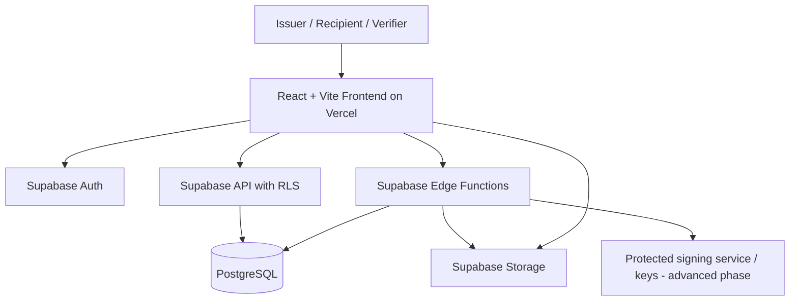

# VeriMark — Digital Credential Issuance and Verification Platform

> **Working project name:** VeriMark\
> **Tagline:** *Issue with confidence. Verify with trust.*\
> **Project type:** Full-stack web application / potential SaaS platform\
> **Proposed stack:** React.js, Vite, TypeScript, Supabase, PostgreSQL, Vercel\
> **Primary audience:** Student organizations, university departments, training providers, community organizations\
> **Status:** Product concept and implementation plan — not yet a launched or accredited service

---

## 1. Executive Summary

**VeriMark** is a web-based platform for authorized organizations to **create, issue, manage, share, and verify digital credentials**. It aims to move beyond ordinary PDF certificates by connecting each issued credential to a controlled digital issuance record, a unique identifier, and a QR-code verification link.

A person evaluating a credential—such as an employer, recruiter, or university administrator—can open its official verification page and check whether the issuer recognizes the credential, whether its identifying details match the presented certificate, and whether the credential is still valid.

VeriMark serves three principal groups:

- **Issuers:** Organizations that create and manage credentials.
- **Recipients:** People who earn and share those credentials.
- **Verifiers:** Third parties who need to confirm their authenticity.

The initial product would focus on **seminar participation, workshop completion, training completion, and student-organization activities**. Later, it could expand to skill credentials, digital badges, portable cryptographic proofs, and integrations with existing learning systems.

**Important trust boundary:** VeriMark verifies issuance and status as represented by its trusted records and controls. It does **not** automatically certify the quality of an event, independently prove every achievement, or grant educational accreditation to an issuing organization.

## 2. Vision and Mission

### Vision

Make trustworthy and easily verifiable digital certificates accessible to organizations of any size, especially those without enterprise credentialing infrastructure.

### Mission

Provide a simple, secure, and accountable workflow for issuing credentials, managing their lifecycle, and allowing recipients to demonstrate legitimate achievements to third parties.

### Value Proposition

**For issuers:** less manual administration and more accountable credential records.\
**For recipients:** convenient access to shareable, verifiable achievements.\
**For verifiers:** a fast way to check credential details without relying on email exchanges with the issuer.

## 3. Real-World Problems

### 3.1 Editable or forgeable document-based certificates

Many certificates circulate as PDFs or images that can be edited or convincingly recreated. Visual appearance alone cannot demonstrate authenticity.

### 3.2 Slow, manual verification

Employers and institutions may need to email or call the original issuer to confirm whether a certificate is authentic. Responses can be delayed or unavailable.

### 3.3 Limited infrastructure for small organizations

Student groups, smaller training providers, and community organizations may not have a dedicated credential database or verification portal.

### 3.4 Fragmented issuance history

Recipients, event organizers, and administrators often distribute records across spreadsheets, email attachments, messaging apps, and cloud folders, making corrections and long-term retrieval difficult.

### 3.5 Scattered achievements for recipients

Students may earn dozens of credentials but lack a coherent place to access and share them.

### Core Problem Statement

> Small educational and community organizations need an accessible and trustworthy method to issue and manage digital certificates, while recipients and verifiers need a convenient way to confirm their authenticity without manual communication.

## 4. Proposed Solution

VeriMark maintains an **authoritative digital credential record** and gives each approved issuance a unique identity and verification URL.

### Primary Workflow

```text
Authorized organization
       |
       v
Create template and prepare recipient records
       |
       v
Review and approve issuance
       |
       v
Create individually identifiable credentials
       |
       v
Generate certificate + QR verification link
       |
       v
Recipient receives and shares credential
       |
       v
Third party opens verification portal
       |
       v
Check issuer, credential details, and current status
```

**Example:** A university engineering organization hosts a cybersecurity workshop for 150 participants. Authorized officers upload a validated recipient list, approve the batch, issue 150 credentials, and share individual verification links. Later, an employer can open a recipient's link and confirm that the organization recognizes that certificate.

## 5. Target Users and Why They Would Use It

| User | Pain point | Benefit from VeriMark |
|---|---|---|
| Student or participant | Certificates scattered across files and emails | Organize, retrieve, and share verified achievements |
| Student organization | Manual certificate generation and inconsistent records | Bulk issuance, consistent templates, and audit trails |
| Training provider | Difficulty maintaining completion history | Credential lifecycle control and searchable issuance records |
| University department | Disconnected event and participation records | Standardized credential administration |
| Employer or recruiter | Uncertainty about certificate authenticity | Fast, account-free verification of issuance and status |
| Program administrator | No way to correct or withdraw issued certificates | Controlled corrections, expiration, revocation, and logs |

### Recipient Experience

A student receives a credential link, views the corresponding certificate, downloads an approved PDF, and shares the verification link when applying for internships or jobs. Creating an account should be **optional** for receiving and sharing an initial credential.

### Issuer Experience

An authorized organization manages members and roles, selects templates, imports recipient data from CSV, previews a batch, approves issuance, and tracks issued or revoked credentials.

### Verifier Experience

A verifier scans a QR code or opens a URL, compares the displayed attributes to the certificate, and sees whether the credential is valid, expired, revoked, or unrecognized.

## 6. Competitive Landscape and Product Differentiation

Existing credential platforms demonstrate that this is a real product category:

- **Accredible:** comprehensive credential issuance, badging, and recipient engagement.
- **Credly:** established digital badging and professional-achievement sharing.
- **Certifier:** certificate creation, bulk issuance, and verification workflows.
- **Sertifier:** certificate issuance, sharing, and integration features.

**Do not claim** that QR codes, bulk issuance, credential wallets, or verification pages are novel features; competing products already offer these capabilities.

### Proposed Differentiators

1. **Small-organization-first onboarding.** A straightforward flow for student organizations, campus departments, and local training groups without enterprise IT teams.
2. **Transparent issuer trust levels.** Differentiate newly registered organizations from organizations whose identity and issuance authority have been reviewed. Explain what each status actually means.
3. **Evidence-based issuance.** Optionally associate credentials with privately stored attendance lists, completion criteria, or reviewer approvals so authorized officers can audit the reason for issuance.
4. **Privacy-conscious verification.** Show only the necessary public fields, avoid exposing recipient directories, and give recipients appropriate sharing controls.
5. **Mobile-first, account-free verification.** Verification should work through a browser and a QR code without requiring verifiers to sign in.
6. **Clear credential lifecycle.** Make replacement, expiration, revocation, and audit events first-class features rather than treating certificates as permanent PDF exports.

These are **proposed positioning advantages**, not proof that other platforms lack these features. Test them with prospective issuers and verifiers before making market claims.

### Positioning Statement

> VeriMark is a lightweight, trust-focused credential platform designed to help smaller organizations issue accountable, verifiable achievements without requiring complex enterprise credentialing infrastructure.

## 7. Product Modules and Functional Requirements

### 7.1 Organization and Issuer Management

- Register an issuer organization and create an organization profile.
- Review organizational identity and the authority of individuals representing it.
- Invite and remove team members.
- Define organization-scoped roles such as **owner**, **issuer**, **reviewer**, and **viewer**.
- Create and manage certificate templates.
- Upload recipient data through validated CSV imports.
- Preview and approve credential batches.
- Audit high-impact administrative changes.

### 7.2 Credential Issuance and Lifecycle

- Create credentials with non-sequential, unpredictable identifiers.
- Store issuer identity, recipient display details, achievement description, issue date, and optional expiration date.
- Issue PDF certificates with QR codes linking to official verification pages.
- Validate proposed credentials before issuing.
- Display lifecycle status.
- Revoke credentials with documented reasons, according to authorization policies.
- Correct errors through tracked replacement or versioning instead of silently editing the original issuance record.
- Preserve key issuance and change events for auditing.

#### Credential Statuses

| Status | Meaning |
|---|---|
| **Valid** | Currently recognized by the issuer and passes the platform's applicable checks |
| **Expired** | The specified validity period has ended |
| **Revoked** | An authorized issuer has withdrawn the credential |
| **Not found** | No matching issuance record can be located |
| **Unable to verify** | Required verification checks could not be completed |

#### Example Credential Record

```json
{
  "credential_id": "VM-2026-A8K72",
  "title": "Certificate of Completion",
  "achievement": "Introduction to Cybersecurity Workshop",
  "recipient_display_name": "Alex Santos",
  "issuer_display_name": "Sample Engineering Society",
  "issued_at": "2026-11-15",
  "expires_at": null,
  "status": "valid"
}
```

*Illustrative data, not an actual issued credential. Production identifiers should be sufficiently unpredictable and not rely on a short sample code alone.*

### 7.3 Recipient Credential Portfolio

- Access individual issued credentials securely.
- Download issued certificate PDFs.
- Share verification URLs.
- Review basic credential details and status.
- Request corrections through an issuer-controlled workflow.
- Optionally create an account for a consolidated credential portfolio in a later release.

### 7.4 Public Verification Portal

- Open a QR verification URL or enter a credential identifier.
- Display current status and issuer identification.
- Show the issuer's reviewed/unreviewed status with an explanation.
- Display approved recipient and achievement fields for comparison.
- Avoid publishing sensitive student identifiers or complete recipient directories.
- Indicate whether any cryptographic proof was checked and distinguish this from database-only verification.
- Rate-limit verification endpoints and prevent unrestricted enumeration of records.

## 8. Verification Design and Security Model

### 8.1 Level 1 — Online Authoritative Database Verification (MVP)

1. An authorized issuer approves a credential.
2. The backend creates a record with an unpredictable identifier.
3. A QR code carries a verification URL.
4. A verifier opens the URL.
5. The platform retrieves the approved public fields and current status.
6. The verifier compares those details with the document presented to them.

**Limitation:** A QR code is an access mechanism, not proof of authenticity by itself. Someone could paste a real QR code onto a modified document. Verification must include a comparison of relevant credential details. Database-only verification also depends on trusting the online platform and its records.

### 8.2 Level 2 — Cryptographically Signed Portable Credentials (Advanced)

1. Produce a canonical, machine-readable statement of the issuer's claims.
2. Sign the payload using the issuer's authorized private signing key under protected server-side control.
3. Deliver the signed credential to the recipient.
4. Verify the signature using an authenticated public key.
5. Separately evaluate issuer authority, expiration, and revocation.

Potential future alignment:

- [W3C Verifiable Credentials Data Model 2.0](https://www.w3.org/TR/vc-data-model-2.0/)
- [1EdTech Open Badges](https://www.1edtech.org/standards/open-badges)

**Security principle:** A valid signature proves that data was signed by a key; it does **not** independently prove that every statement in the data is true. Trust in the issuer and its validation process remains essential.

### 8.3 Required Security Controls

- Authenticate users through Supabase Auth.
- Apply PostgreSQL Row Level Security (RLS) to enforce organizational isolation.
- Implement authorization on the backend, not just in React components.
- Restrict privileged issuance and revocation to designated roles.
- Maintain protected audit records of sensitive changes.
- Protect private evidence and template assets through storage policies.
- Keep service-role credentials and private signing keys out of the client bundle.
- Validate file uploads and CSV contents.
- Enforce request-size limits and throttling where relevant.
- Use least privilege for all service operations.
- Test cross-organization access-denial scenarios.

### 8.4 Privacy and Compliance

- Collect only the minimum required personal information.
- Limit public verification fields to those necessary for verification.
- Do not publicly expose email addresses, student numbers, birthdates, or recipient directories by default.
- Establish a privacy notice, retention policy, and correction process.
- Review processing obligations under the Philippine **Data Privacy Act of 2012 (RA 10173)** where applicable.
- Obtain appropriate permissions and use genuine, consented data for pilots.

## 9. Technology Stack

| Area | Recommended technology | Role |
|---|---|---|
| UI | React.js + Vite + TypeScript | Client application |
| Styling | Tailwind CSS + shadcn/ui | Responsive interface and reusable components |
| Routing | React Router | Page navigation |
| Server-state fetching | TanStack Query | Query caching and request states |
| Forms | React Hook Form + Zod | Form handling and validation |
| Authentication | Supabase Auth | Sign-in and sessions |
| Database | Supabase PostgreSQL | Relational credential and organization records |
| Authorization | PostgreSQL RLS | Data-access enforcement |
| File storage | Supabase Storage | Templates, documents, and private evidence |
| Privileged backend logic | Supabase Edge Functions + Postgres RPC | Issuance, signing, and guarded operations |
| Certificate PDFs | pdf-lib or equivalent | File generation |
| QR codes | Maintained QR code library | Verification URL encoding |
| Unit/component tests | Vitest + React Testing Library | Frontend correctness |
| E2E tests | Playwright | User workflow testing |
| Deployment | Vercel | Static React hosting and previews |
| Version control | GitHub | Repository and CI workflows |

A separately hosted Express.js server is **not required** for the MVP. Supabase handles the persistent backend, while Edge Functions and database functions can implement privileged actions.

## 10. High-Level System Architecture



### Suggested Data Entities

| Table | Responsibility |
|---|---|
| `profiles` | User profiles |
| `organizations` | Registered issuer organizations |
| `organization_members` | Tenant membership and organization roles |
| `issuer_reviews` | Organization identity and authorization reviews |
| `credential_templates` | Template configuration |
| `credential_batches` | Bulk issuance batches |
| `credentials` | Credential records and current status |
| `credential_versions` | Issued content and tracked replacements |
| `credential_events` | Lifecycle transitions |
| `issuer_signing_keys` | Public key metadata and key lifecycle references, not client-readable private keys |
| `audit_logs` | Sensitive operations and actor records |

### Suggested Application Roles

- **Platform administrator:** Manages platform-level issuer reviews and abuse handling.
- **Organization owner:** Controls organization membership and organization settings.
- **Issuer:** Creates and issues credentials within assigned permissions.
- **Reviewer:** Reviews or approves batches if approvals are enabled.
- **Organization viewer:** Reads permitted organization records without issuing.
- **Recipient:** Accesses their own credential collection if registered.
- **Public verifier:** Uses a restricted public verification workflow without an account.

## 11. MVP Scope and Priorities

### MVP — Must Have

- [ ] Responsive React app and accessible navigation
- [ ] User authentication
- [ ] Organization creation and issuer authorization review
- [ ] Organization membership and role-based access control
- [ ] One or more certificate templates
- [ ] Validated single and CSV batch issuance
- [ ] Individually identifiable issued credentials
- [ ] PDF generation with QR verification links
- [ ] Public, limited-data credential verification page
- [ ] Credential expiration and revocation
- [ ] Basic issuance history and audit logs
- [ ] Basic usage metrics
- [ ] Automated security tests for RLS and tenant boundaries
- [ ] Production deployment and documentation

### Post-MVP — Enhancements

- [ ] Recipient credential wallet and collection management
- [ ] Multi-step issuance approval workflows
- [ ] Cryptographically signed portable credentials
- [ ] Standards-oriented W3C/Open Badges support
- [ ] External API and learning-system integrations
- [ ] Advanced dispute and correction workflows
- [ ] Organization analytics and trend reporting
- [ ] Organization branding and additional templates
- [ ] More sophisticated delivery and notification methods

### MVP Acceptance Criteria

The MVP is functionally complete when:

1. An approved organization's authorized member can create and issue a credential.
2. An intended recipient can access that credential and its verification URL.
3. A verifier can confirm the official displayed details and current status without registering.
4. An authorized issuer can revoke or replace a credential with an auditable record.
5. Unauthorized users cannot access another organization's private records or perform privileged operations.
6. The deployed application passes core end-to-end tests.

## 12. Suggested Development Phases

### Phase 1 — Discovery and Validation

- Interview a small number of prospective issuers and recipients.
- Observe current certificate issuance practices.
- Identify actual problems and measurable baseline effort.
- Confirm that an organization is willing to test a pilot.

### Phase 2 — Foundations

- Establish repository, environments, and branch strategy.
- Implement database migrations, RLS policies, auth, organization roles, and reusable UI components.
- Write authorization tests before building sensitive issuance flows.

### Phase 3 — Credential Creation

- Implement templates, CSV import validation, batch preview, approval, and guarded issuance.
- Generate PDFs and QR verification URLs.

### Phase 4 — Verification and Lifecycle

- Build public verification views, expiry logic, revocation, correction/versioning, and audit history.
- Test forged identifiers, mismatched details, unauthorized actions, and invalid status transitions.

### Phase 5 — Pilot and Evidence

- Run a limited pilot with an authorized student organization or training group.
- Collect real issuance and verification metrics with appropriate privacy safeguards.
- Fix usability and reliability problems.

### Phase 6 — Case Study and Expansion

- Publish architecture diagrams, implementation decisions, test results, deployment notes, and pilot outcomes.
- Evaluate cryptographic signing and standards support only after the core workflow is reliable.

## 13. Free Hosting and Operating Constraints

**Proposed starter deployment:** Vercel Hobby + Supabase Free + GitHub.

Illustrative free-tier allocations discussed during project planning (verify the current provider pricing and terms before launch):

| Platform | Free-tier considerations |
|---|---|
| Vercel Hobby | Free hosting for eligible personal, non-commercial usage; preview deployments |
| Supabase Free | Approximately 500 MB database storage and 1 GB file storage, with other usage limits |
| Supabase Auth | Suitable for an early small-scale pilot, subject to published limits |
| Supabase Edge Functions | Invocation quotas apply |
| GitHub | Repository hosting and CI features within plan limits |

### Important Limitations

- Free Supabase projects may pause after prolonged inactivity.
- Automatic backups and production reliability assurances may be limited on free plans.
- Supabase's default email service has restrictive limits; production recipient emails may require a separate SMTP provider.
- Vercel Hobby has **non-commercial usage restrictions**. Reassess hosting eligibility before organizational or commercial deployment.
- Large batches of certificate PDFs can consume storage quickly; evaluate whether to generate files on demand and set sensible retention policies.
- Free-tier capacity is appropriate for an initial demonstration or bounded pilot, not a promise of unlimited production availability.

**MVP cost-saving decision:** Begin with downloadable PDFs, exportable recipient links, and QR verification. Defer automated bulk email until a suitable delivery provider and budget are available.

## 14. Real-World Pilot and Credibility Plan

The strongest proof of value is **verified use by a real organization**, not the number of features in a demo.

### Suggested Pilot

1. Obtain permission from one student organization or department.
2. Agree on a legitimate workshop, event, or training activity.
3. Confirm an authorized issuer and an approved recipient list.
4. Issue the event's genuine credentials through VeriMark.
5. Give recipients their links and test public verification with appropriate consent.
6. Collect operational metrics and feedback.
7. Document limitations, incidents, and improvements honestly.

### Suggested Success Metrics

| Metric | What it demonstrates |
|---|---|
| Number of real credentials issued | Actual adoption |
| Time to issue a batch | Administrative efficiency |
| Successful verification attempts | Functional utility |
| Verification failures | Reliability and usability risks |
| Correction and issuance errors | Data quality |
| Issuer/recipient feedback | User satisfaction |
| Returning organizations | Ongoing product usefulness |

**Do not fabricate adoption figures or present seed records as real production data.**

### Portfolio Evidence to Publish

- Problem statement backed by user interviews
- Product requirements and user flows
- Database and multi-tenant architecture diagram
- Security assumptions, RLS policies, and test coverage
- Credential lifecycle and audit design
- CI/CD and deployment approach
- Usability findings and pilot measurements
- Engineering trade-offs and lessons learned

## 15. Long-Term Product and Business Potential

VeriMark could eventually become a credential-as-a-service platform for smaller educational and community organizations. Possible future business capabilities include larger issuance quotas, team workflows, integrations, custom branding, and advanced analytics.

Avoid adopting pricing or monetization assumptions before validating actual organizational demand. Also consider availability, support, and hosting obligations before using the system for institutionally important records.

### Potential Extensions

- Skills-based badges and competency endorsements
- Portable, standards-based verifiable credentials
- Enterprise and LMS integrations
- Recipient-managed credential collections
- Export and portability tools to reduce platform lock-in
- Localized experiences for regional educational organizations

## 16. Risks and Constraints

| Risk | Mitigation |
|---|---|
| Someone impersonates a school or organization | Distinct issuer review and authorization process; clear trust labels |
| A genuine QR is attached to a modified certificate | Require comparison with official displayed details; explore signed payloads |
| A recipient's private data is exposed | Minimal public fields, restrictive RLS and storage policies |
| A privileged user issues false certificates | Scoped permissions, optional approvals, event logs, and accountability |
| Credentials are silently changed after issuance | Versioning or replacement records; retain lifecycle events |
| Free hosting is unavailable during a verification | Clear operational limits, backup/export plans, and a migration strategy |
| The product overpromises legitimacy | Clearly separate technical proof of issuance from independent accreditation |
| Product name conflicts with an existing business | Trademark, domain, and competitive-name checks before public launch |

## 17. Project Name and Branding Caution

**VeriMark is a working name.** Other verification-related products have used similar names, including offerings associated with `verimark.co` and `verimark.io`.

Before publishing or registering the product, independently check:

- Relevant trademarks in target jurisdictions
- Current brand and app name usage
- Domain availability
- Repository, package, and social handle availability

Do not infer trademark clearance solely from domain availability.

## 18. Suggested Project Description for a Portfolio

> **VeriMark** is a full-stack digital credential issuance and verification platform designed to help educational institutions, student organizations, and training providers manage accountable records of achievement. It combines structured credential issuance, unique identifiers, QR-based verification, organization-scoped access control, credential lifecycle management, and auditability. Built using React.js, TypeScript, Supabase, PostgreSQL, and Vercel, the platform aims to make trustworthy credential management accessible to smaller organizations without enterprise infrastructure.

*This describes the intended product scope. After implementation, update it to distinguish completed features from planned capabilities and report pilot outcomes only when measured.*

## 19. Project Evaluation

| Dimension | Assessment | Rationale |
|---|---|---|
| Real-world usefulness | High potential | Addresses recognizable issuance and verification friction |
| Full-stack engineering depth | High | Multi-tenancy, authorization, auditability, file generation, lifecycle logic |
| Originality of category | Moderate | Established category; differentiation depends on focus and execution |
| Pilot feasibility | Relatively high | One willing student organization can validate the core workflow |
| Portfolio potential | High if executed well | Strong technical case study and measurable adoption possible |
| Operational complexity | Moderate to high | Identity assurance, privacy, revocation, and availability matter |

## 20. Recommended Next Step

**Build the trust and verification workflow before polishing certificate design.** Start by validating demand with a real issuer, then ship the simplest secure version that can approve an organization, issue an identifiable credential, verify its current status, and record a defensible audit trail.

---

### Reference Links for Further Research

- [W3C — Verifiable Credentials Data Model v2.0](https://www.w3.org/TR/vc-data-model-2.0/)
- [1EdTech — Open Badges](https://www.1edtech.org/standards/open-badges)
- [Supabase Pricing](https://supabase.com/pricing)
- [Vercel Pricing](https://vercel.com/pricing)
- [Supabase Documentation](https://supabase.com/docs)
- [React Documentation](https://react.dev/)
- [Philippines National Privacy Commission](https://privacy.gov.ph/)

*Note: Vendor limits, competitor capabilities, and legal requirements change. Recheck current primary sources before final product or deployment decisions.*
